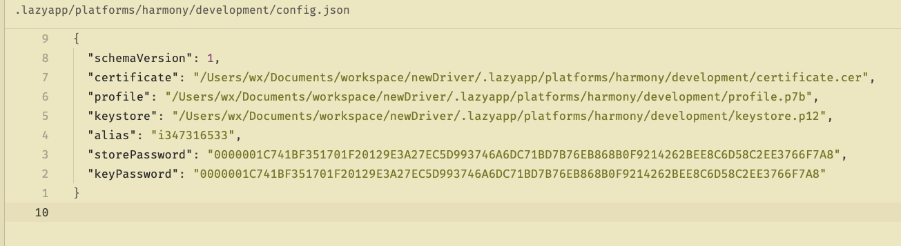

- [x] 参照 `other-spec.md` 完成并优化本项目 `spec.md`。
- [x] 实现第一阶段：初始化向导、配置编辑、文件管理、只读 Doctor。
- [x] 完成行为测试、lint 和实际终端闭环验证；记录见 `spec.md` 第 12 节。

 加一下这几个
 还有 web 端优化一下ux布局，让操作更加友好，以及合理，还有 tui，以及目录结构是否合理呢？有需要优化的吗？
